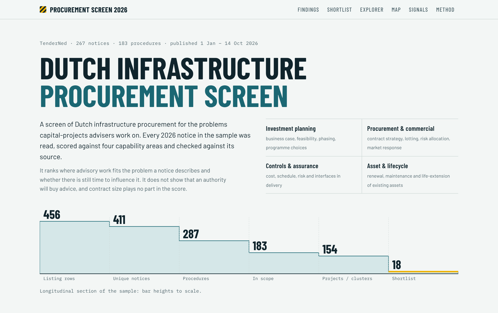
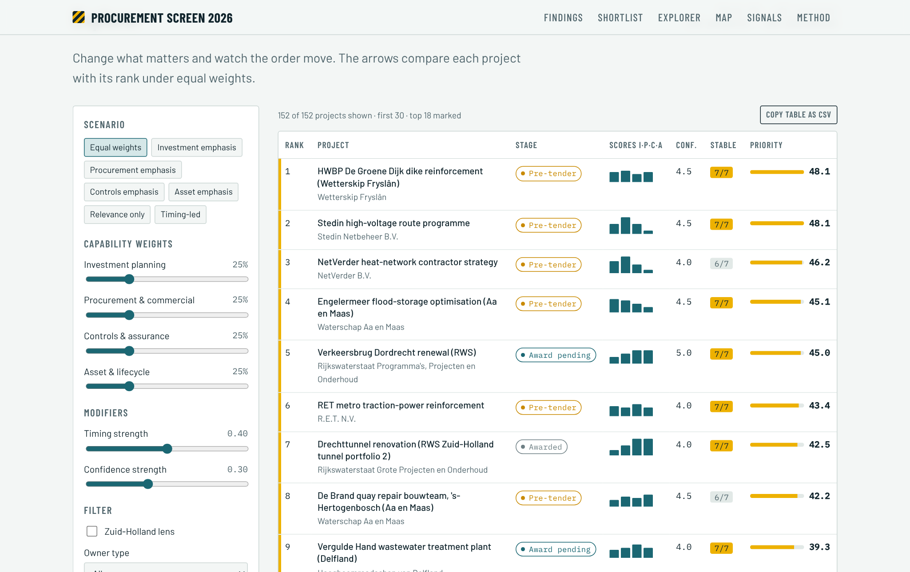

# Dutch Infrastructure Procurement Screen 2026

Screening 183 Dutch infrastructure procurements from 2026 for relevance to capital-projects advisory work: investment planning, procurement and commercial management, project controls and asset lifecycle management.



**Website:** open `docs/index.html` in a browser (data, map and fonts are inside the file), or enable GitHub Pages from the `/docs` folder.

## What it does

1. **Collects** 267 TenderNed notices published 1 Jan – 14 Oct 2026 across energy, transport, water, renewal and advisory categories, and groups them into 183 in-scope procedures and 154 projects or programmes.
2. **Scores** each procedure 1–5 on four capability areas with a published rubric. Text rules give a first score; every record was then read and 187 scores adjusted, each with a written reason. Contract size is not a criterion.
3. **Ranks** by priority = relevance × timing × evidence confidence, with adjustable weights, and tests the ranking under seven weighting scenarios.
4. **Keeps delivery signals separate**: grid-capacity dependence, delivery exposure and advisory position are shown beside the score, not in it.
5. **Validates** 26 notices field by field against the official TenderNed PDFs.

## Findings

- **Open strategy questions sit with regional and network owners.** Water authorities, grid and heat companies and transport operators are consulting the market on how to contract and phase work; most Rijkswaterstaat projects in the sample are already awarded or in delivery.
- **Renewing assets that stay in use shows up as contract change.** The sample holds 51 modification notices on 22 running contracts in 2026.
- **Grid constraints show up in the contractor market.** 45 procedures depend on new grid capacity, but none is located precisely enough to join to congestion data; the notices instead show framework increases and programme ramp-ups by grid operators.

The shortlist of 18 projects, with evidence, gaps and sources for each, is in [`reports/phase4_shortlist.md`](reports/phase4_shortlist.md). Eight of the 18 stay in the top 18 under all seven weighting scenarios.



## Repository

| Folder | Content |
|---|---|
| `raw/` | Transcribed TenderNed listings and detail records; map boundary sources |
| `scripts/` | Pipeline, run in order `01` → `11`; weights in `scoring_config.json` |
| `data/` | Outputs: notices, procedures, scores, clusters, sensitivity, shortlist, validation |
| `reports/` | Collection log, scoring model, constraint assessment, shortlist, methodology and validation |
| `site/` | Website source (`src.html`), data bundle and fonts |
| `docs/` | Built website (`index.html`) and screenshots |

Key datasets:

| File | Rows | Content |
|---|---|---|
| `data/master_dataset.csv` | 183 | Every in-scope procedure with rule and reviewed scores, evidence, confidence, timing, priority, exposure and cluster |
| `data/review_adjustments.csv` | 187 | Every reviewer change to a rule score, with the reason |
| `data/clusters.csv` | 154 | Projects and programme clusters, ranked |
| `data/sensitivity.csv` | 152 | Rank under seven weighting scenarios (clusters above the confidence threshold) |
| `data/shortlist.csv` | 18 | Annotated shortlist |
| `data/screening_log.csv` | 287 | In/out-of-scope decision per procedure, with the triggering term |
| `data/validation_results.csv` | 26 | Field-by-field check against the official notice PDFs |

## Reproduce

```
pip install -r requirements.txt
python scripts/01_consolidate.py
python scripts/02_merge_details.py
python scripts/03_score.py
python scripts/04_exposure.py
python scripts/05_shortlist.py
python scripts/06_sensitivity.py
python scripts/07_validate.py
python scripts/08_shortlist.py
python scripts/09_phase4_report.py
python scripts/10_export_site.py
python scripts/11_build_site.py
```

## Limits

- A stratified sample, not a census; it leans towards May–October 2026.
- Notice descriptions were paraphrased by a language model during extraction; identifiers and codes were checked against the official PDFs.
- The need for advisory work is inferred from scope, procedure and stage. It is not a confirmed requirement unless the notice buys advice directly.
- Only 4 of 183 notice descriptions state a contract value.
- Grid-congestion data could not be retrieved and no notice is located to a site, so no grid figures are used.
- One reviewer applied the rubric.

Full discussion: [`reports/phase5_methodology_validation.md`](reports/phase5_methodology_validation.md).

## Note

Independent portfolio study. Not affiliated with or endorsed by any firm or public authority named here. Scores are screening judgements for further investigation.
